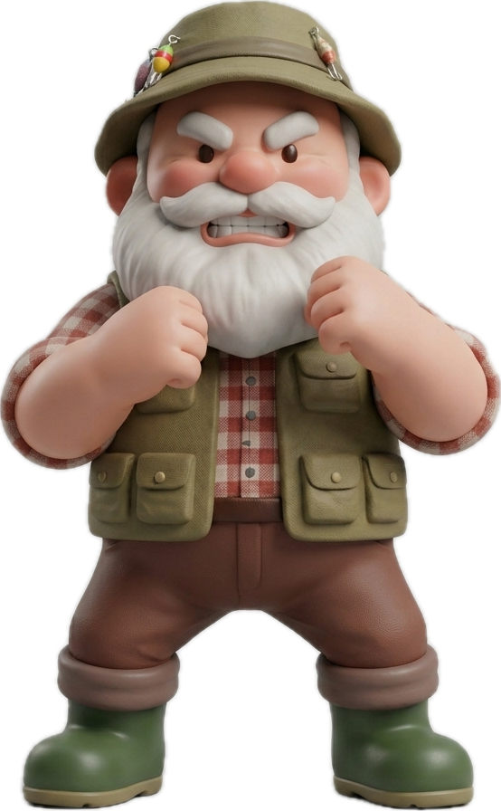

# Fish All Day

**Uncle Farter, the most useless uncle in your Mac family.** Wild manners. Proudly useless.

<p align="center"></p>

A free Mac app and website. A grumpy, retired 3D cartoon uncle lives in a see-through strip on top of your Mac's Dock.
He fishes all day while you work, begs you for beer money, farts and blames you, and makes you reel in his lunch.
He was modelled, rigged and animated with **Aholo Lux3D**.

Built for the Manycore Aholo Global 3D AI Hackathon (#Manycorehackathon).

| | |
|---|---|
| **Play it in the browser** | https://fishallday.pages.dev (he walks in along the bottom of the page) |
| **Mac app** | Download from the website or from this repository's Releases (free, macOS 13+, Apple silicon) |
| **Trailer (55 s)** | [design/launch/trailer/fish-all-day-trailer.mp4](design/launch/trailer/fish-all-day-trailer.mp4), filmed from the real app |
| **Project report (PDF)** | [design/report/fish-all-day-report.pdf](design/report/fish-all-day-report.pdf) |

## What he does

- Walks in, unfolds his camping chair and casts his line off your Dock.
- Finds his cooler empty and asks you for $5 ("Give him $5" is pretend money, nothing is charged). Ignore him and he nags and shakes your screen. Pay him and he jogs off and comes back with a can.
- Farts (a green puff) and blames you. Hums, dozes off, snores, wakes up grumpy.
- A fish bites: a "!" with a ten-second ring and a Mac notification. Grab him and hold the mouse to reel. Land it and he dances to a banjo; the fish goes in your fish book and today's count shows in the menu bar.
- Ignore the bite or reel too hard and the fish pulls him into the lake. He climbs out soaked.
- Work too long (about 50 minutes) and he throws a stone at your screen (a visual crack) to make you take a break.
- Poke him and he scolds you. 159 recorded lines in a 1930s cartoon sailor voice; swear words are bleeped.
- Hover him for a toolbar: mute his voice, mute all sound, or send him home.

## Made with Aholo Lux3D

| Step | Aholo tool | Result |
|---|---|---|
| Modelling sheets | Aholo image tool (Lux3D multimodal to image) | The concept turned into clean A-pose and T-pose sheets of the same character (`design/aholo/oldman-a`, `oldman-ta`) |
| Character model | Lux3D 3D generation (G1) | Uncle Farter in 335 s, about 54,000 faces (`models/oldman/model.glb`) |
| Skeleton | Lux3D auto-rig | Rigged in 64 s, mesh kept (`models/oldman/rig.glb`) |
| Moves | Lux3D move library | 34 moves on his rig: sit, walk, jog, cast, drink, talk, dance, fall, climb and more |
| Props | Lux3D G1-Turbo | Camping chair, cooler, beer can and fish, 70 to 95 s each (`models/prop-*`) |
| Close-up repaints | Aholo image tool | Face, hands and palms repainted and projected back onto the texture (`design/aholo/redraw-*`) |
| Website hero | Aholo image tool | The boxer pose above (`design/aholo/hero-fists`) |

30 image jobs in total (39 to 71 s each). The prompts are in `design/aholo-prompts/`; the scripts that call Aholo are
`tools/aholo-image.mjs`, `tools/aholo-3d.mjs`, `tools/aholo-rig.mjs` and `tools/aholo-moves.mjs` (Aholo SDK
`@manycore/aholo-sdk-lux3d`; put your key in `.env`, see `.env.example`).

Library moves are made for slim bodies, so his are fitted to a round one: a lift and two-bone leg IK keep his boots flat
in the chair, his arms stay outside his belly, chest and beard, a push keeps him off the backrest, and his fingers grip
the rod and the can (`web/src/character.js`, `web/src/deskman.js`).

## How it is built

```
web/     the 3D scene (three.js): desk.html is him on the edge of the screen; src/ has the character, his routines,
         the fishing game, sounds and voice
mac/     the Mac app: a Swift see-through panel just above the Dock that serves web/ inside a WKWebView; clicks pass
         through everywhere except on him (checked 30 times a second)
site/    the landing page (fishallday.pages.dev), with the same live uncle along the bottom
tools/   Aholo scripts, voice generation, filming and trailer tools, the report builder, and checks (tools/check/)
models/  the original Lux3D models (character, rig, props)
design/  Aholo outputs, prompts, stills, the trailer, the report and its source
```

## Run it

```bash
# the 3D scene in a browser
cd web && npm install && npm run dev          # then open http://127.0.0.1:5180/desk.html

# the Mac app (needs Xcode command line tools)
mac/build.sh run                              # builds mac/build/Fish All Day.app and opens it
mac/build.sh dmg                              # makes mac/build/Fish-All-Day.dmg

# the landing page
site/build.sh                                 # builds site/dist (serve it with any static server)
```

The Mac app is signed ad hoc, not notarized, so macOS asks once on first launch: open System Settings > Privacy &
Security and choose **Open Anyway**. It makes no internet connections and asks for no permissions.

## Credits

- 3D character, rig, moves and props: Aholo Lux3D. Modelling sheets, repaints and hero art: the Aholo image tool.
- Rendering: [three.js](https://threejs.org) (MIT).
- Voice: designed and generated with ElevenLabs; lines written by the team.
- Sound effects: CC0 from Openverse / Freesound (`web/public/assets/sfx/CREDITS.json`).
- Trailer music: Mixkit (free licence).
- Fonts: Luckiest Guy, Bowlby One SC, Shrikhand, Bitter (SIL Open Font Licence).
